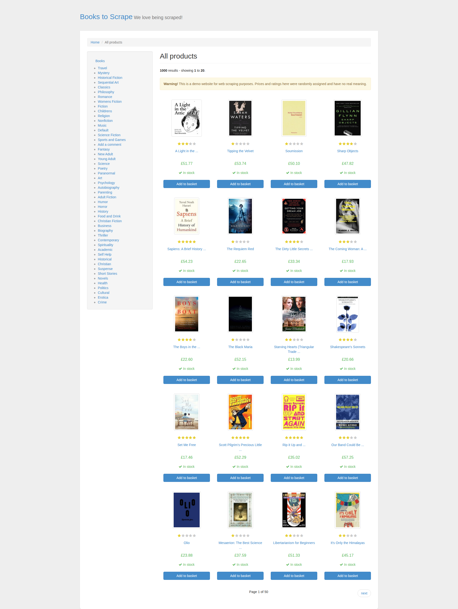
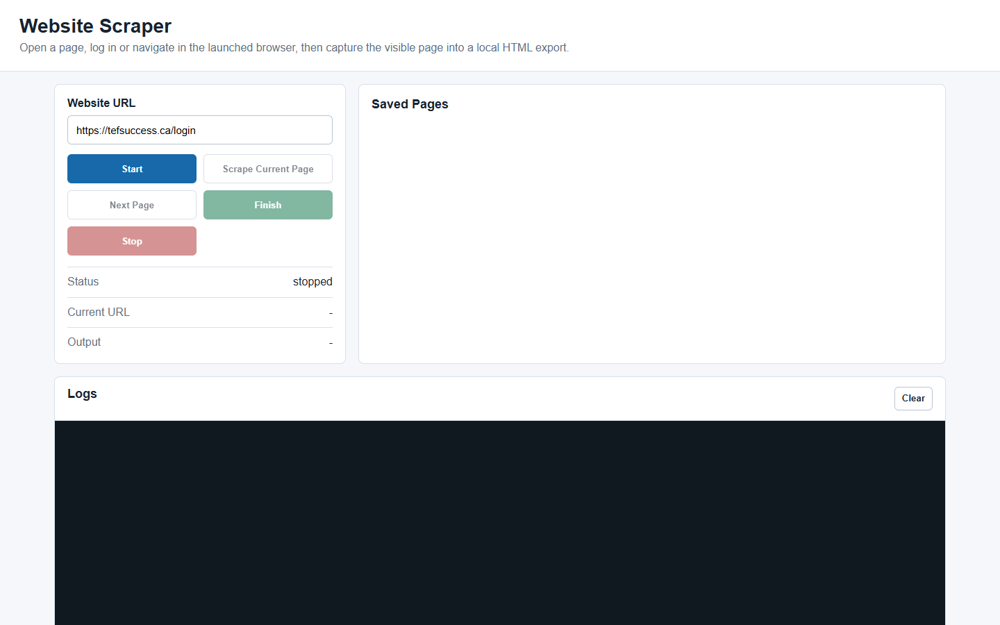

# Playwright Website Scraper Pro

[](LICENSE)
[](https://github.com/mafzalkalwardev/playwright-website-scraper-pro/actions/workflows/ci.yml)
[](.github/workflows/ci.yml)
[](package.json)



Open a page you are allowed to access, then keep the rendered HTML, the visible text, a full-page screenshot, and the page's assets. For a headless crawl that writes CSS-selected fields to a dataset, use the Actor in [`apify-actor/`](apify-actor/).

The image above is the full-page PNG from an Actor run against [Books to Scrape](https://books.toscrape.com/) with `saveScreenshots` turned on (`maxPages` 1). The run stored it as `SCREENSHOT-3060d727707e.png` and saved 20 dataset items from that catalogue page. The first item:

```json
{
  "url": "https://books.toscrape.com/",
  "pageTitle": "All products | Books to Scrape - Sandbox",
  "screenshotKey": "SCREENSHOT-3060d727707e.png",
  "title": "A Light in the Attic",
  "price": "£51.77",
  "availability": "In stock"
}
```

**Setup:** `git clone https://github.com/mafzalkalwardev/playwright-website-scraper-pro.git && cd playwright-website-scraper-pro && npm install && INDUS_SKIP_LICENSE=1 npm start`

`npm install` runs `npx playwright install`. The server listens on port 3000, or on `PORT` when that variable is set. Open `http://localhost:3000`.

## Why this exists

[`CASE_STUDY.md`](CASE_STUDY.md) describes the job: capture a site for a redesign, an audit, or an offline replica, including screenshots, assets, and more than one page. The Express app and the Tkinter desktop app drive a headed Chromium window you can log into and click through, then save the page that is actually on screen. The Actor in [`apify-actor/`](apify-actor/) is the headless path: start URLs, an optional same-hostname link selector, and named CSS fields.

## What you can run

### Local capture

`npm start` runs `server.js`. It serves `public/index.html` and exposes:

| Method | Path | Action |
| --- | --- | --- |
| `POST` | `/start` | Launch the scraper for an `http` or `https` URL |
| `POST` | `/scrape-current` | Save the visible page |
| `POST` | `/next-page` | Click a visible next / older / more / continue control |
| `POST` | `/finish` | Write the export index and close the browser |
| `POST` | `/stop` | Kill the scraper process |
| `GET` | `/status` | Current run state |
| `GET` | `/events` | Server-sent events for logs and state |

The desktop UI is `desktop_app.py` (Python 3 and Tkinter):

```bash
python desktop_app.py
```

`scraper_engine.js` is the capture engine. On each scrape it writes, under `downloaded_site/<timestamp>/` (or under `SCRAPER_HOME` when that variable is set):

- `page_NNN.html` with downloaded asset URLs rewritten to local files
- `page_NNN.txt` with the page's visible text
- `page_NNN.png`, a full-page screenshot
- `assets/` for files it was able to download
- `index.html` linking the saved pages
- `browser-downloads/` for files the browser itself downloads

The engine uses a persistent Chromium profile in `browser_profile/` and runs headed. Startup calls `requireIndusLicense`. That check looks for an `indus-license*.json` file in the project directory or in `data/`, unless `INDUS_SKIP_LICENSE` is `1`, `true`, `yes`, or `on`.



### Apify Actor

[`apify-actor/`](apify-actor/) is a separate Node package. It crawls with Crawlee's `PlaywrightCrawler` and the Apify SDK, extracts the fields you name with CSS selectors, and can store a full-page PNG in the run's key-value store. Input, output, and deploy steps are in [`apify-actor/README.md`](apify-actor/README.md). Local input falls back to [`apify-actor/INPUT.json`](apify-actor/INPUT.json), which points at Books to Scrape.

From `apify-actor/`, with Node.js 20 or newer:

```bash
npm install && npx playwright install chromium && npm start
```

On the platform, from that same directory after `apify login`: `apify push`. The image is `apify/actor-node-playwright:22-1.64.1`.

### Windows build and Docker

`npm run build:exe` runs `scripts/build-exe.ps1` on Windows. It needs the Playwright browsers and the .NET Framework C# compiler, and it produces `release/WebsiteScraper.exe`.

The root [`Dockerfile`](Dockerfile) is `node:20-bookworm-slim` and starts `node server.js` with `PORT=5000`. The same license check applies inside the container.

## Responsible scraping

Crawl pages you are allowed to access. Read the site's terms and its robots.txt, and stay inside the access rules and rate limits they set. The maintainers are not responsible for misuse.

Books to Scrape, the host used for the screenshot, labels itself a demo site for web scraping. Its `/robots.txt` URL returned 404 when this page was written, so confirm the current file and the site's terms yourself before you depend on them. On any other site, check both before you run.

## Current limits

These match the tree today:

- `server.js`, `desktop_app.py`, `scripts/build-exe.ps1`, and `package.json` `"main"` refer to `Scraper.js`. The engine source in the repo is `scraper_engine.js`.
- `node scraper_engine.js <url>` exits with `ERR_AMBIGUOUS_MODULE_SYNTAX` because the file calls `require()` and also has a top-level `await requireIndusLicense(...)`.
- `npm run app` runs `python app.py`. That file is not in the repo. The GUI source is `desktop_app.py`.

## Contributing

See [CONTRIBUTING.md](CONTRIBUTING.md), [CODE_OF_CONDUCT.md](CODE_OF_CONDUCT.md), and [SECURITY.md](SECURITY.md). The license is [MIT](LICENSE).

**Author:** Muhammad Afzal Kalwar ([@mafzalkalwardev](https://github.com/mafzalkalwardev)). GitHub [@mafzalkalwardev](https://github.com/mafzalkalwardev) · LinkedIn [@mafzalkalwardev](https://www.linkedin.com/in/mafzalkalwardev) · WhatsApp [+92 307 9670503](https://wa.me/923079670503) · [Portfolio](https://mafzalkalwardev.github.io) · [Email](mailto:kalwarmuhammadafzal3@gmail.com)

If this helped, a star helps others find it.
