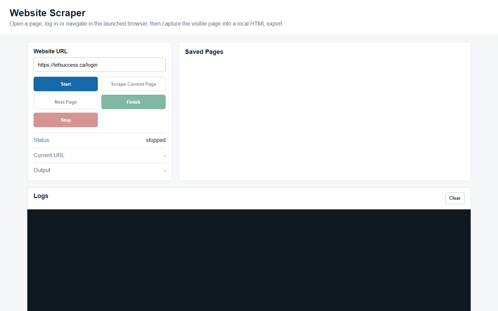

<div align="center">

# Playwright Website Scraper Pro


<p>
  
  
  
  
</p>

<p>
  
</p>

<p>
  <strong>Advanced website scraping and cloning toolkit with Playwright, desktop GUI, Express backend, screenshots, asset downloading, and multi-page export.</strong>
</p>

</div>

---

## Contribution Snake

<div align="center">
  <picture>
    <source media="(prefers-color-scheme: dark)" srcset="https://raw.githubusercontent.com/mafzalkalwardev/google-voice-dispatch-agent/output/github-contribution-grid-snake-dark.svg">
    <source media="(prefers-color-scheme: light)" srcset="https://raw.githubusercontent.com/mafzalkalwardev/google-voice-dispatch-agent/output/github-contribution-grid-snake.svg">
    
  </picture>
</div>

---

## SEO Keywords

`Playwright scraper` `website cloner` `asset downloader` `web automation`

---

## Screenshots



Run `npm start` locally and capture additional views using demo URLs only.

## 🐍 Contribution graph

<picture>
  <source media="(prefers-color-scheme: dark)" srcset="https://raw.githubusercontent.com/mafzalkalwardev/mafzalkalwardev/output/github-contribution-grid-snake-dark.svg" />
  <source media="(prefers-color-scheme: light)" srcset="https://raw.githubusercontent.com/mafzalkalwardev/mafzalkalwardev/output/github-contribution-grid-snake.svg" />
  
</picture>

---

## 🚀 Quick start

```powershell
git clone https://github.com/mafzalkalwardev/playwright-website-scraper-pro.git
cd playwright-website-scraper-pro
npm install
npm start
```

Open the desktop GUI or API URL shown in the console (default Express server). See project docs for GUI and export options.

---

## Compliance and Responsible Use

This project is intended for lawful research and automation on sites you are authorized to access. Respect website terms of service, robots.txt where applicable, rate limits, and copyright. Collect public data only; do not abuse credentials or bypass access controls.

The maintainers are not responsible for misuse of this software.

**Status:** Production-ready toolkit · use demo URLs for screenshots and recordings

---

---

---

## Case Study (Problem → Stack → Result)

### Problem
Clients needed website capture/cloning workflows with screenshots, assets, and multi-page export for redesigns, audits, and offline replicas.

### Stack
Playwright, Node.js/Express, desktop GUI, asset downloader, multi-page export

### Result
Built a scraper/clone toolkit that automates page walks, captures screenshots and assets, and exports structured project output for faster redesign and research work.

**Audience:** Web agencies, redesign teams, researchers

📄 Full write-up: [`CASE_STUDY.md`](./CASE_STUDY.md)

**Hire / contact:** GitHub [@mafzalkalwardev](https://github.com/mafzalkalwardev) · LinkedIn [@mafzalkalwardev](https://www.linkedin.com/in/mafzalkalwardev) · WhatsApp [+92 307 9670503](https://wa.me/923079670503) · [Portfolio](https://mafzalkalwardev.github.io) · [Email](mailto:kalwarmuhammadafzal3@gmail.com)

## Discoverability

**Author:** Muhammad Afzal Kalwar ([@mafzalkalwardev](https://github.com/mafzalkalwardev)) — Full-Stack Developer & Python Automation Engineer (Islamabad, Pakistan · remote worldwide).

**Hire / contact:** GitHub [@mafzalkalwardev](https://github.com/mafzalkalwardev) · LinkedIn [@mafzalkalwardev](https://www.linkedin.com/in/mafzalkalwardev) · WhatsApp [+92 307 9670503](https://wa.me/923079670503) · [Portfolio](https://mafzalkalwardev.github.io) · [Email](mailto:kalwarmuhammadafzal3@gmail.com)

### Who is this for?
Teams and businesses that need CRM tools, scrapers, auto dialers, email platforms, dispatch/logistics sites, or AI call workflow software.

### FAQ
- **Who built this?** Muhammad Afzal Kalwar (`mafzalkalwardev`).
- **Can I hire the author?** Yes — remote freelance and contract. See contact links above.
- **Related work?** Browse [all repositories](https://github.com/mafzalkalwardev?tab=repositories) and the [live portfolio](https://mafzalkalwardev.github.io).

<details>
<summary><strong>SEO / GEO / AEO keywords</strong></summary>

Muhammad Afzal Kalwar, mafzalkalwardev, playwright-website-scraper-pro, full-stack developer, Python automation engineer, Islamabad Pakistan, freelance remote developer, CRM scraping dialer email AI tools, express, screen-capture, playwright, nodejs, automation, web-scraping, electron, ocr, javascript

</details>

---

## Contact

| Channel | Handle / Number |
|:--|:--|
| GitHub | [@mafzalkalwardev](https://github.com/mafzalkalwardev) |
| LinkedIn | [@mafzalkalwardev](https://www.linkedin.com/in/mafzalkalwardev) |
| WhatsApp | [+92 307 9670503](https://wa.me/923079670503) |
| Portfolio | [mafzalkalwardev.github.io](https://mafzalkalwardev.github.io) |
| Email | [kalwarmuhammadafzal3@gmail.com](mailto:kalwarmuhammadafzal3@gmail.com) |
